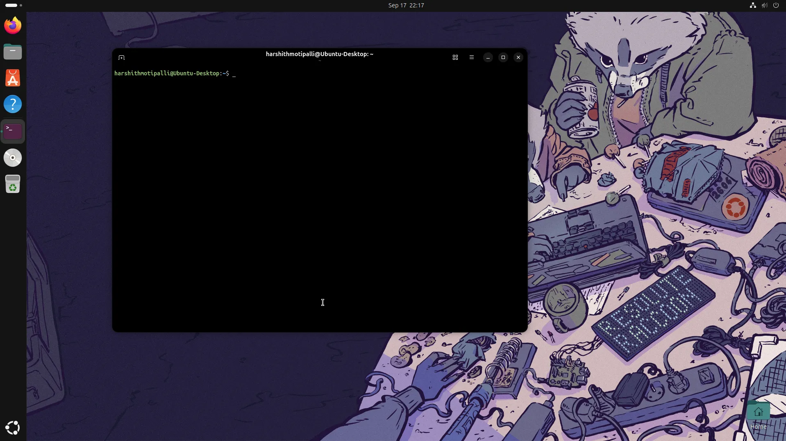
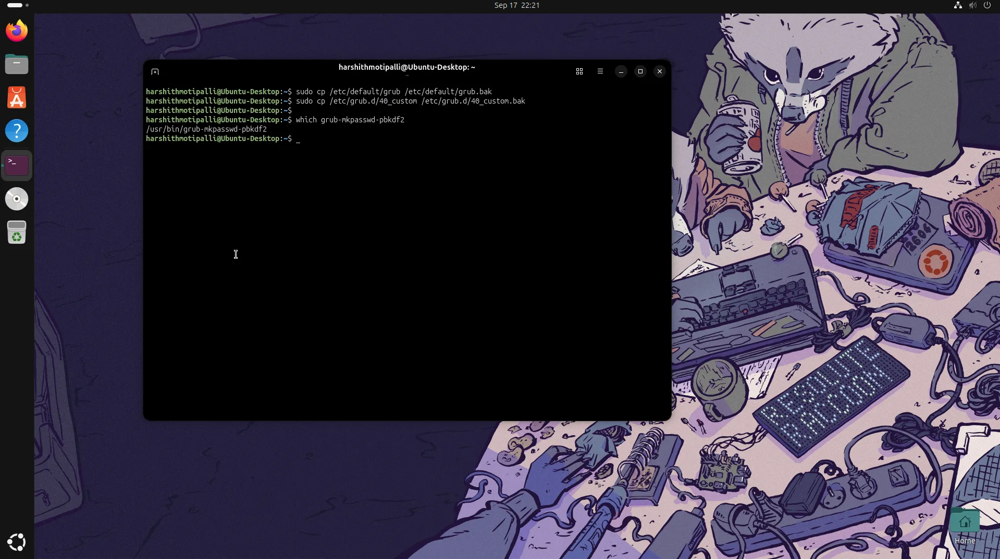
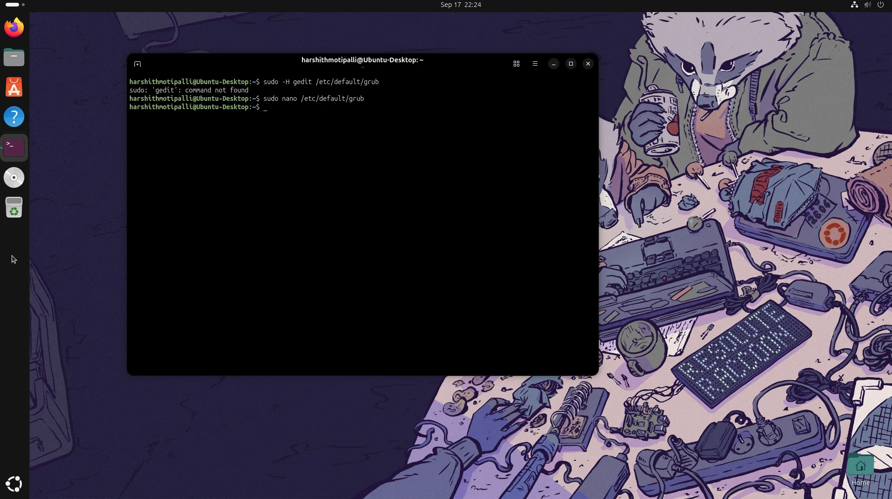
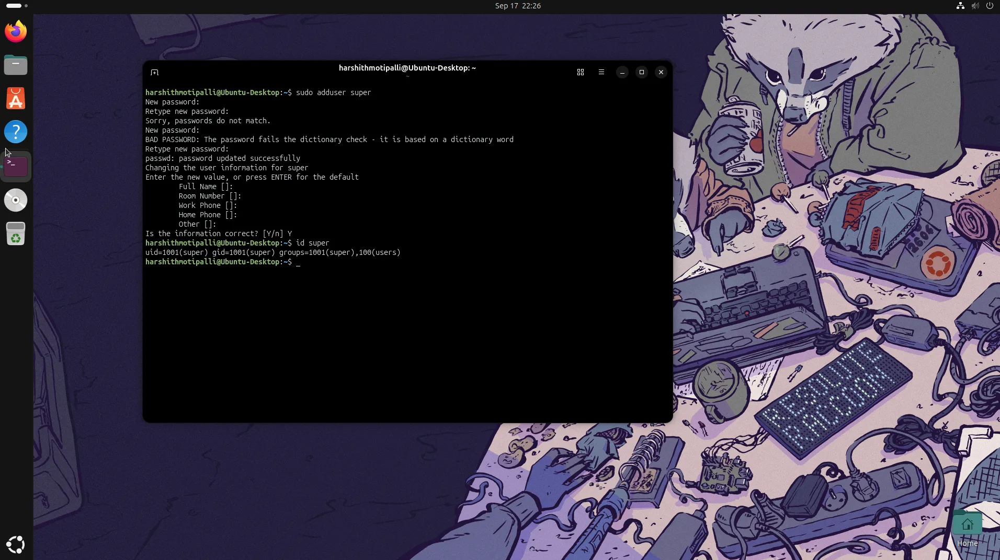
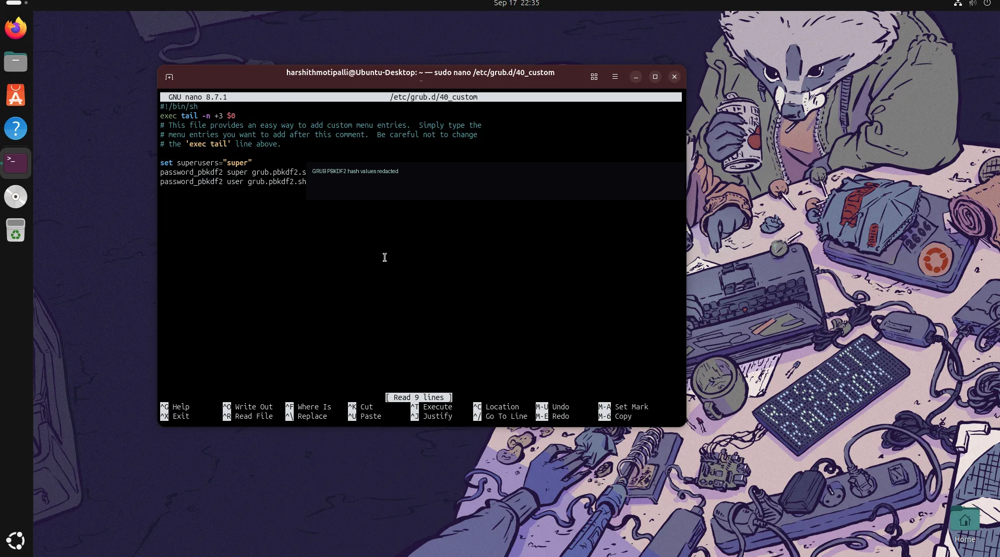
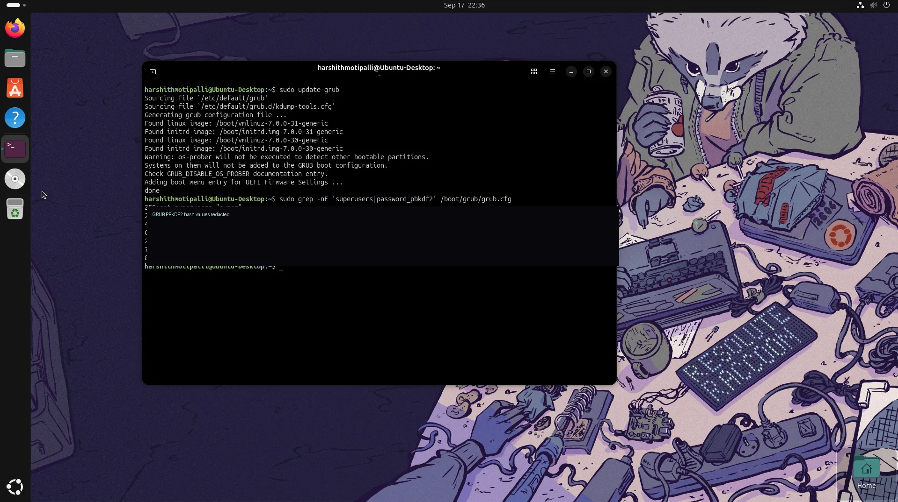
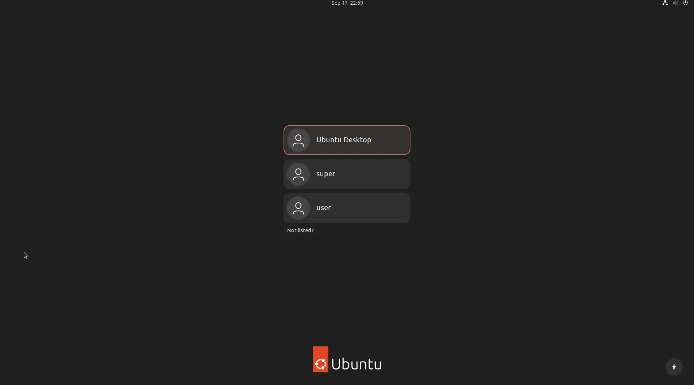
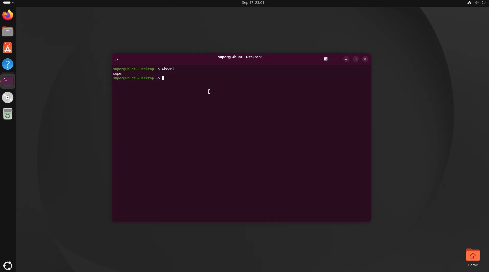
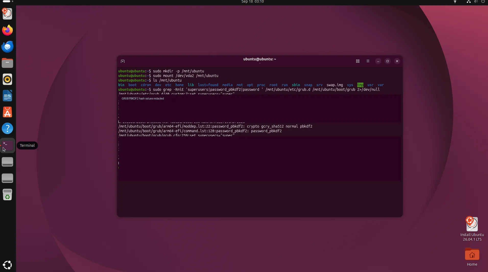

# CYSE 211 — Lab 2: GRUB Bootloader Security Hardening

  

Configured and assessed **GNU GRUB bootloader security** on an Ubuntu virtual machine. The lab covers backing up GRUB settings, limiting interactive boot-menu exposure, defining a GRUB superuser and standard user with **PBKDF2 password verifiers**, regenerating boot configuration, testing an authentication prompt, and inspecting the installed configuration from an Ubuntu live environment.

**Lab report:** [View the fourteen-page PDF (redacted public copy)](docs/CYSE211_Lab2_Report_Redacted.pdf)

## At a glance

| Item | Details |
|---|---|
| Focus | GRUB bootloader access controls and boot configuration |
| Environment | Ubuntu virtual machine and live recovery desktop |
| Tools | GRUB, grub-mkpasswd-pbkdf2, nano, update-grub, grep and Linux account utilities |
| Configured profiles | GRUB superuser super and standard user user |
| Reported boot settings | GRUB_DEFAULT=0, GRUB_TIMEOUT_STYLE=hidden, GRUB_TIMEOUT=0 |
| Verification | GRUB configuration regeneration, authentication prompt, Linux login and recovery inspection |
| Evidence | 13 screenshots and a fourteen-page redacted lab report |

## Assessment Workflow

## Evidence Screenshots

All **13 screenshots appear directly below** in report order. Screenshots and the public PDF have sensitive GRUB PBKDF2 hash values masked.

### 01. Baseline Ubuntu environment

*Captured the starting Ubuntu desktop before modifying the bootloader.*

### 02. GRUB configuration backups

*Backed up GRUB configuration files and checked for the grub-mkpasswd-pbkdf2 utility.*

### 03. GRUB configuration editor

*The gedit command was unavailable; nano was used to open the GRUB defaults.*

### 04. Create the super account

*Created the super Linux account and verified its UID, GID and groups.*

### 05. Create the standard user

*Created the user Linux account and verified its distinct UID and GID.*

### 06. Configure GRUB authentication

*Added superuser and user PBKDF2 password-verifier entries to custom GRUB configuration; hashes are masked in this public copy.*

### 07. Regenerate GRUB configuration

*Ran update-grub and inspected the generated grub.cfg for authentication entries.*

### 08. Normal Ubuntu startup

*Observed normal Ubuntu desktop startup after the bootloader changes.*

### 09. GRUB credential challenge

*Observed GRUB request a username and password when authentication was required.*

### 10. Ubuntu login profiles

*The graphical login screen displayed Ubuntu Desktop, super and user identities.*

### 11. Verify super account login

*The whoami command confirmed an interactive session for super.*

### 12. Ubuntu live recovery environment

*Launched an Ubuntu live environment to inspect the installed system.*

### 13. Inspect GRUB from live system

*Mounted the installed root partition and inspected GRUB authentication entries; password-derived hashes are masked.*

## Findings and Evidence

| Finding | Lab evidence |
|---|---|
| Recovery preparation | Backups of the default and custom GRUB configuration were created before changes. |
| Boot menu configuration | The report documents a hidden GRUB timeout configuration; a subsequent screenshot shows normal Ubuntu startup. |
| Account separation | Distinct local super and user identities were confirmed with id; an interactive super session was confirmed with whoami. |
| Password-based GRUB protection | set superusers and password_pbkdf2 entries were recorded, and a credential prompt was observed. |
| Generated configuration | update-grub completed and a grep check located authentication directives in grub.cfg. |
| Recovery inspection | A live Ubuntu environment was used to mount the root filesystem and inspect the installed GRUB configuration. |

## What This Project Demonstrates

- Understanding of GRUB startup behavior and bootloader configuration.
- Backing up and modifying privileged Linux boot settings.
- Implementing administrative and standard GRUB identities using password-derived verifiers.
- Validating generated boot configuration and interactive authentication prompts.
- Investigating the installed system from a live recovery environment.
- Publishing evidence while protecting password-hash material.
